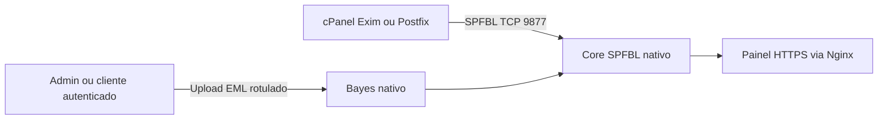

# Arquitetura

## Componentes

| Componente | Responsabilidade | Exposição |
|---|---|---|
| Core SPFBL | Reputação, DNSBL, tickets e consultas SPFBL | TCP 9877 somente para MTAs autorizados; UDP 53 quando houver DNSBL |
| Nginx | TLS e painel web | HTTPS |
| Cliente cPanel/Postfix | Consulta o envelope ao core | Saída TCP para a VM central |
| SPAMD opcional do Exim | Encaminha mensagem elegível para inspeção nativa de conteúdo | TCP 9877, apenas MTAs autorizados |
| Bayes nativo | Aprende mensagens `.eml` com rótulos explícitos no painel | Parte do core SPFBL |

As integrações em `integrations/cpanel` e `integrations/postfix` consultam somente o envelope SPFBL. O instalador legado `client/spamfox.cpanel.sh` e o DirectAdmin podem habilitar o protocolo SPAMD para mensagens elegíveis do Exim; nesse caso o core recebe a mensagem para inspeção de URLs, anexos e Bayes. Quando uma mensagem é associada a ticket e fila, ela pode ficar em `incoming/` para processamento interno e é removida após até sete dias.

Usuários autenticados treinam o Bayes global da instância ao enviar `.eml` rotulados pelo painel. O upload de treinamento processa o conteúdo em memória e armazena somente o modelo; previsões não viram rótulos automáticos.

Consulte [Integrações](../integrations/README.md) para os limites e procedimentos de cada MTA.
