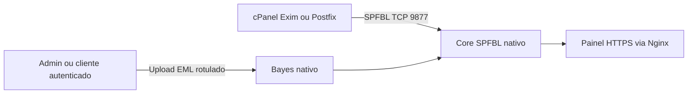

# Arquitetura

## Componentes

| Componente | Responsabilidade | Exposição |
|---|---|---|
| Core SPFBL | Reputação, DNSBL, tickets e consultas SPFBL | TCP 9877 somente para MTAs autorizados; UDP 53 quando houver DNSBL |
| Nginx | TLS e painel web | HTTPS |
| Cliente cPanel/Postfix | Consulta envelope ao core | Saída TCP para a VM central |
| Bayes nativo | Aprende mensagens `.eml` com rótulos explícitos no painel | Parte do core SPFBL |

Os clientes MTA consultam o envelope SPFBL e não enviam mensagens completas. Usuários autenticados treinam o Bayes global da instância ao enviar `.eml` rotulados pelo painel. O core processa o conteúdo em memória e armazena somente o modelo; previsões não viram rótulos automáticos.

Consulte [Integrações](../integrations/README.md) para os limites e procedimentos de cada MTA.
