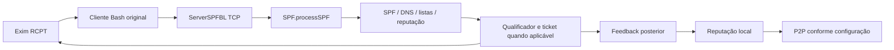

# Arquitetura original SPFBL

Baseline: `7b0232e96f16faca151340b80c418838a800237f`, auditada em 2026-10-01. O core, os clientes e os dados upstream permanecem sem alterações. Este documento descreve a implementação; a arquitetura HAD proposta está em [HAD-ANTISPAM-ARCHITECTURE.md](HAD-ANTISPAM-ARCHITECTURE.md).

## Inicialização e componentes

O entry point é `net.spfbl.core.Core.main` (`src/net/spfbl/core/Core.java:2712`). Ele adquire lock JUnique, lê `spfbl.conf` relativo ao diretório de trabalho (`:977-983`), carrega caches (`:2731`) e inicia serviços e threads. Portanto, o working directory faz parte do contrato de instalação: `./data/`, `./web/` e a configuração precisam estar no diretório esperado.

| Componente | Responsabilidade e evidência |
|---|---|
| `Core` | Configuração, lifecycle, serviços opcionais e codecs de tickets; `Core.java:977-1060,2712-2835,283-354` |
| `Server` | Carregamento/persistência coordenados, logging, DNS/WHOIS e criptografia local; `core/Server.java:130-165,232-267,283-303,1616-1713` |
| `AdministrationTCP` | Comandos de cadastro, listas, peers, STORE e SHUTDOWN; socket TCP em `:118`, dispatcher em `:312` |
| `ServerSPFBL` | Consultas TCP, protocolo Postfix e SPAMD; dispatcher encaminha consulta para `SPF.processSPF` em `service/ServerSPFBL.java:1600` |
| `spf.SPF` | SPF, decisão de envelope, tickets, feedback e `Distribution`; `spf/SPF.java:4867,5505-5544,6996,7367` |
| `data.Reputation` | Flags locais suavizadas e composição com hierarquias; separado da distribuição HAM/SPAM |
| `Client` / `User` | Identidades de servidores por IP/CIDR, permissões, usuários, queries e histórico; ver [PROTOCOL.md](PROTOCOL.md) |
| `Peer` / `ServerP2P` | Políticas por peer, contadores binomiais, BLOCK e transporte UDP; ver [SPFBL-P2P-AUDIT.md](SPFBL-P2P-AUDIT.md) |
| `ServerDNS` / `dns.Zone` | Serviço de zonas DNSBL/DNSWL/SCORE, opcional na inicialização |
| `ServerHTTP` | Interface web, autenticação, tickets, feedback e checagem de URLs; o scan de segurança da iteração anterior foi cancelado e deixou apenas material parcial arquivado |
| `ServerSMTP` | Implementação SMTP experimental, condicionada a testing/configuração e diretórios de fila; `Core.java:2770-2795` |
| `client/` | Integrações distintas TCP/Bash, DNS/Perl, cPanel, DirectAdmin, Postfix etc.; não são intercambiáveis |

## Fluxo de consulta

O formato atual TCP é `SPF 'IP' 'MAIL FROM' 'HELO' 'RCPT TO' [exists]`. As aspas fazem parte do protocolo, não só de uma chamada shell. `SPF.java:5517-5544` remove o primeiro/último caractere dos campos e permite espaços no sender até a aspa final. Uma integração nova precisa validar campos antes de serializá-los. O servidor não consome uma requisição REST nesse fluxo.

Não existe um único score global. O binomial local em `spf.SPF.Distribution` pode agregar HAM/SPAM de peers com teto por correlação; o modelo `data.Reputation` mantém flags locais por entidade/hierarquia. DNSBL/DNSWL/score externos são particularmente usados pelo cliente Perl; não presumir que toda consulta TCP passa pelos mesmos hosts. Detalhes em [SPFBL-REPUTATION.md](SPFBL-REPUTATION.md) e [SPFBL-EXTERNAL-SERVICES.md](SPFBL-EXTERNAL-SERVICES.md).

## Estado e persistência

`Server.loadCache():130-165` e `storeAll():232-267` coordenam Client, User, Peer, listas, SPF, DNS/HTTP, WHOIS e reputação moderna. Os formatos incluem serialização Java `.map`, journals/textos `.txt` e chave local `./data/server.key`. MySQL é opcional em `run/spfbl.conf`; não foi necessário para compilar ou iniciar o laboratório.

Um backup precisa preservar configuração, todo o estado relevante e chaves de tickets como conjunto consistente. Copiar só reputação e perder a chave quebra o feedback de tickets existentes. O utilitário nativo instalado na VM preserva `/etc/had-antispam`, todo `data/` e `history/`, exclui apenas locks transitórios e recusa restore entre versões. Unit tests, restore isolado do core e primeiro backup operacional com checksum/restore dry-run passaram; cópia para destino separado, restore entre hosts, RPO/RTO e compatibilidade entre releases continuam pendentes. Consulte [BACKUP-RESTORE.md](BACKUP-RESTORE.md).

O `data/` upstream contém dados históricos reais. O laboratório começou com `data/` vazio e não os importou para evitar confundir reputação herdada com aprendizado local. Isso limita a comparação com uma instância pública.

## Serviços, defaults e fronteiras

`run/spfbl.conf:50-58` habilita ADMIN 9875/TCP, SPFBL 9877/TCP e HTTP 80/TCP; hostname está comentado. HTTPS, DNSBL e serviços adicionais são opcionais. No laboratório, HTTP/P2P ficaram desabilitados e a saída de rede foi isolada. ADMIN faz bind wildcard no código; uma publicação de portas Docker ou firewall aberto pode torná-lo alcançável.

Foram registrados resultados de laboratório em [SPFBL-SECURITY-AUDIT.md](SPFBL-SECURITY-AUDIT.md). O scan da iteração anterior foi cancelado; esse material é parcial e histórico, não uma validação completa. O core de desenvolvimento continua isolado e o foco da próxima etapa é o adapter HAD em MONITOR.

P2P não inicia sem hostname adequado e o bootstrap Matrix é chamado antes da criação do socket P2P; um primeiro start vazio não entra automaticamente. Não habilitar participação pública presumindo confiança/admissão automática.

## Evidência e limites

Compilação de 59 fontes Java 8, inicialização e consultas TCP reais estão em [TEST-RESULTS.md](TEST-RESULTS.md). Atualização operacional de 2026-10-02: o core foi instalado nativamente na VM; o cliente upstream cPanel está ativo e uma transação real recebeu GREYLIST com adiamento SMTP temporário. A integração upstream não implementa o requisito HAD de fail-open. O adapter próprio está em MONITOR e ainda não foi conectado ao hook Exim ativo; entrega após retry, rebuild/rollback reais e malha P2P continuam sem prova operacional. Consulte [NATIVE-DEPLOYMENT-REPORT.md](NATIVE-DEPLOYMENT-REPORT.md).
