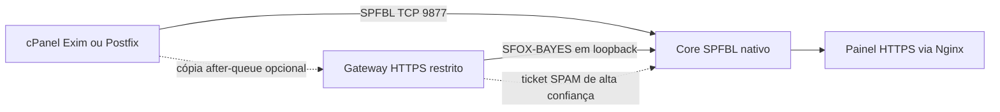

# Arquitetura

## Componentes

| Componente | Responsabilidade | Exposição |
|---|---|---|
| Core SPFBL | Reputação, DNSBL, tickets e consultas SPFBL | TCP 9877 somente para MTAs autorizados; UDP 53 quando houver DNSBL |
| Nginx | TLS, painel e rota restrita de análise | HTTPS |
| Cliente cPanel/Postfix | Consulta envelope ao core | Saída TCP para a VM central |
| Gateway de conteúdo | Recebe cópias after-queue e consulta o Bayes nativo | HTTPS restrito por IP |
| Bayes nativo | Pontua conteúdo e aprende somente com rótulos explícitos | Parte do core SPFBL |

A decisão SMTP continua no MTA e no SPFBL. O gateway encaminha ao core uma cópia da mensagem já aceita, portanto a pontuação Bayes não atrasa nem rejeita a entrega original. O conteúdo permanece na VM central, não é enviado a peers e não é gravado pelo gateway. Previsões não viram rótulos de treinamento. Quando habilitado, o feedback envia ao SPFBL somente um ticket de SPAM elegível; nunca envia corpo ou assunto.

Consulte [Integrações](../integrations/README.md) para os limites e procedimentos de cada MTA.
