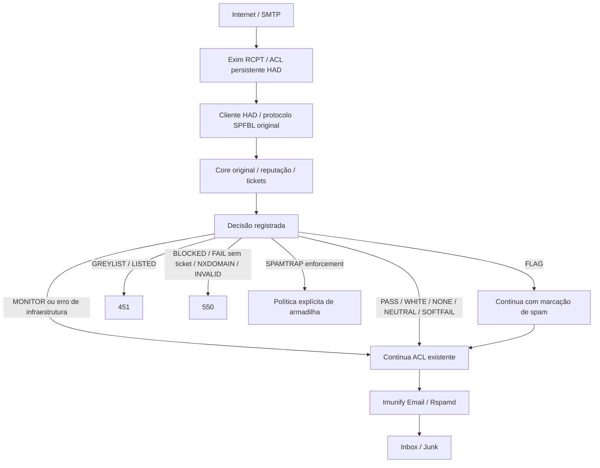

# Arquitetura alvo HAD AntiSpam

Proposta derivada da auditoria de `7b0232e96f16faca151340b80c418838a800237f`. Este documento descreve a arquitetura alvo, não o estado operacional completo nem uma mudança do algoritmo original. Atualização de 2026-10-02: o adapter está instalado no cPanel de homologação e seu hook Exim permanece ativo somente em MONITOR; o estado observado está em [NATIVE-DEPLOYMENT-REPORT.md](NATIVE-DEPLOYMENT-REPORT.md).

## Decisão e responsabilidade

A primeira camada decide durante RCPT se o remetente deve ser aceito, usando IP, HELO, MAIL FROM e RCPT TO. A mensagem aceita continua pelo Imunify/Rspamd existente. WHITE não deve desativar inspeção de conteúdo; PASS não deve usar um `accept` antecipado que pule verificações cPanel restantes.

`FAIL` com ticket tem tratamento distinto no cliente upstream (equivalente a suspeita), ao contrário de `FAIL` sem ticket. A política HAD precisa preservar essa diferença até decisão explícita e testada; não bloquear toda resposta iniciada em FAIL. HOLD requer preservar a relação ticket/feedback, sem executar congelamento em MONITOR. A tabela completa está em [PROTOCOL.md](PROTOCOL.md).

## Cliente e ACL

O protótipo `integrations/cpanel/had_antispam_client.py` valida campos não confiáveis, limita conexão a 500 ms e consulta ao core a 800 ms, aceita IP literal e não resolve DNS na consulta. O hook RCPT `warn` preserva tickets validados em estado de mensagem. Um hook DATA separado chama o adapter com os metadados de mensagem e transmite o `HEADER` upstream somente se houver ticket; toda resposta fica em MONITOR e não muda o resultado Exim. Exim descartável 4.98.2 confirmou wire format, múltiplos RCPT, headers, reset, caminho sem ticket e logs sem tokens; o core local respondeu `NOT FOUND` a ticket sintético inexistente. O cPanel Exim 4.100.1 validou previamente o hook RCPT, mas ainda não recebeu nem testou o novo hook DATA. O gerenciador DATA tem snapshot/rollback próprios e preserva o hook RCPT.

Para Postfix, `integrations/postfix/` implementa um serviço `spawn` privado em `smtpd_recipient_restrictions`. O handler consome o protocolo policy de Postfix, consulta o mesmo comando SPF de envelope usado pelo Exim e devolve sempre `DUNNO`. O instalador preserva a ordem da lista existente, adiciona a policy somente depois de uma regra de proteção relay, exige Postfix 3+ para `default_action=DUNNO`, testa configuração e core com envelope sintético e mantém rollback byte a byte se a configuração não divergir depois da instalação. O pacote ainda não foi instalado em host Postfix real.

MONITOR será o default: consulta, decide e registra, porém nunca deny/defer/discard/freeze ou comando de fila. O ensaio fake SMTP comprovou a consulta por recipient e o reset de `acl_m_*` após MAIL/RSET; esses invariantes ainda precisam de validação no hook ativo com o serviço adapter.

As ACLs devem entrar nos hooks persistentes do cPanel, sem editar `/etc/exim.conf`. O instalador precisa reconhecer cPanel/Exim/Imunify/SpamAssassin, salvar conteúdo/metadados/ausência dos arquivos envolvidos, validar a configuração candidata, rebuild, teste e rollback em erro. Uninstall deve restaurar o snapshot exato e preservar mudanças independentes detectadas posteriormente, evitando sobrescrita silenciosa.

### Transporte cPanel → core

O DNS `antispam.hadcloud.srv.br` identifica a VM; não é necessário outro hostname para o MVP. O protocolo TCP do SPFBL não cifra consultas. No cPanel, Exim conversa com o adapter pelo socket Unix local `0660`; o adapter consulta `127.0.0.1:19877`; um túnel SSH iniciado pelo cPanel encaminha esse TCP local para `127.0.0.1:19877` na VM. Na VM, um sidecar na rede Docker interna encaminha uma linha pelo socket Unix compartilhado ao listener SPFBL `core:9877`. O core não publica portas no host.

A conta e a chave SSH são dedicadas, sem shell/TTY, com `restrict,port-forwarding,permitopen="127.0.0.1:19877"`; o bloco `Match User` usa `AllowTcpForwarding local`, `PermitOpen 127.0.0.1:19877` e nega StreamLocal, agente, X11 e sessões. O ensaio descartável em `packaging/dev/ssh-tunnel-smoke.py` e uma consulta originada no cPanel de homologação comprovaram MONITOR ao core real; ADMIN `9875` não é alcançável por essa identidade. Os bridges estão na VM com reinício após reboot e os serviços de túnel/adapter estão instalados no cPanel. O endereço DNS atual basta; não é necessário outro registro. O hook ACL do Exim permanece inativo.

FLAG não equivale a Junk confirmado por presença de header. A homologação precisa demonstrar classificação/entrega no stack Imunify do servidor. SPAMTRAP accept-drop em ACL RCPT com múltiplos destinatários requer teste de escopo para não descartar destinatários legítimos da mesma mensagem.

Estrutura cPanel atual: `integrations/cpanel/{install,uninstall,update,healthcheck}.sh`, manager Python, cliente compartilhado e snippet de RCPT MONITOR. O manager valida via `buildeximconf --acl_dry_run`, gera snapshot, recompõe Exim, executa sessão fake SMTP `-bh` com consulta ao core e faz rollback se uma etapa falhar. Os testes locais do manager usam comandos simulados; a evidência do host real registra o hook ativo em MONITOR e os dois rebuilds/reloads validados. A integração Postfix fica separada em `integrations/postfix/`, com seu próprio protocolo policy, gerenciador e rollback.

## Core, administração e reputação

Preservar Java, protocolo, ticket, persistência e os dois modelos existentes. API REST/dashboard são segunda fase. Nenhum PostgreSQL, Redis ou serviço Python é necessário para substituir funções que já existem no core.

ADMIN ficará em rede de gestão isolada; o código original permite mutações sem autenticação nessa porta. CPFBL de clientes será restrito aos IPs autorizados, com transporte protegido conforme viabilidade. Cadastro por CIDR não protege dados em TCP claro contra atacante no caminho.

HAD_LOCAL, SPFBL_P2P e EXTERNAL_DNSBL são origens desejadas para observabilidade futura, não namespaces já implementados. Uma malha lógica HAD independente é possível com cadastro explícito, porém RFC1918/ULA encontra restrições no HELO/FQDN original. O híbrido precisa impedir propagação de BLOCK público para malha privada e validar políticas reais: REPUTATION também importa/enfileira bloqueios no baseline.

Participação pública, critérios de admissão e validade operacional das fontes externas permanecem NÃO CONFIRMADOS. Não remover dependências `*.spfbl.net` por substituição textual ou rebranding.

## Estado, privacidade e operação

Persistir metadados de evento: timestamp, servidor, IP, HELO, sender, recipient, SPF/decisão, ticket, ação e latência. Não coletar senha, SMTP AUTH, corpo, anexos ou segredos no MVP. Proteger também tickets e chave local em logs/exports. O core original tem funções de conteúdo/SMTP; não habilitá-las indiscriminadamente no MVP de envelope.

Backup/restore têm utilitários versionados instalados na VM e passaram por teste unitário, restore isolado no core, backup operacional de 39 arquivos e restore dry-run; cópia para destino separado, restore entre hosts, RPO/RTO e compatibilidade entre releases ainda são gates pendentes. `had-antispam status`, `/health` e `/metrics` estão instalados na VM central e responderam com o core ativo; carga permanece gate próprio. Rebranding só depois da auditoria, mantendo licença/atribuições. O estado por gate está em [AUDIT-STATUS.md](AUDIT-STATUS.md); resultados executados em [TEST-RESULTS.md](TEST-RESULTS.md).
